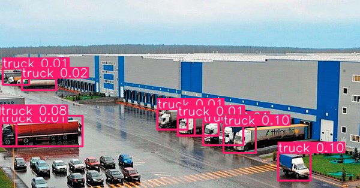
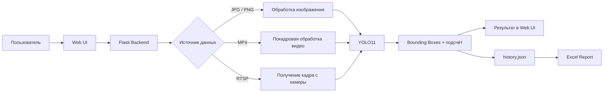

# Truck Detection & Counting — учёт грузовиков на логистическом терминале


Веб-приложение для **обнаружения и подсчёта грузовиков на территории логистического терминала** с использованием дообученной модели YOLO11.

Система принимает изображения, видео и RTSP-потоки с камер, выполняет детекцию грузовиков, визуализирует результат, сохраняет историю обработок и формирует отчёт в Excel.

> Проект разработан в рамках производственной практики и демонстрирует полный цикл интеграции модели компьютерного зрения в веб-приложение.

## Возможности

- Детекция грузовиков на изображениях `.jpg`, `.jpeg`, `.png`
- Покадровая обработка видео `.mp4`
- Получение и обработка кадра из **RTSP-потока**
- Подсчёт обнаруженных грузовиков
- Отображение изображения с bounding boxes
- Сохранение истории запросов в `history.json`
- Просмотр истории обработок через веб-интерфейс
- Генерация Excel-отчёта
- Логирование этапов обработки и ошибок

## Демонстрация

Пример результата детекции:



Веб-интерфейс позволяет загрузить файл или указать адрес RTSP-потока, после чего отображает число обнаруженных грузовиков и визуализированный результат.

## Задача

Цель проекта — автоматизировать визуальный контроль транспорта на территории логистического центра.

Вместо ручного просмотра изображений и видеопотоков приложение использует модель детекции объектов, которая локализует грузовики на кадре и возвращает их количество.

Для повышения качества детекции использовалась предобученная модель YOLO11, дообученная на специализированных данных для логистических сцен.

Датасет, использованный в рамках практики:  
[Roboflow Universe — Logistics Dataset](https://universe.roboflow.com/roboflow-ngkro/logistics-h0uec/dataset/10)

## Архитектура



## Стек

| Компонент | Технологии |
|---|---|
| Язык | Python |
| Детекция объектов | Ultralytics YOLO11 |
| Computer Vision | OpenCV |
| Backend | Flask |
| Frontend | HTML, CSS, JavaScript, Tailwind CSS |
| Работа с данными | NumPy, pandas |
| История | JSON |
| Отчёты | pandas, openpyxl, Excel |
| Работа с файлами | Werkzeug |

## Как работает обработка

### Изображения

1. Пользователь загружает изображение.
2. Flask сохраняет его в `static/uploads/`.
3. Модель YOLO выполняет детекцию.
4. Приложение считает найденные bounding boxes.
5. Формируется изображение с разметкой.
6. Результат добавляется в историю.

### Видео

Видео обрабатывается покадрово. Для каждого кадра выполняется детекция грузовиков, после чего приложение рассчитывает **среднее количество обнаруженных грузовиков по кадрам**.

Это не трекинг уникальных автомобилей: один и тот же грузовик может присутствовать на нескольких кадрах.

### RTSP

Для RTSP-потока приложение подключается к указанному адресу камеры, получает кадр, выполняет детекцию и выводит аннотированное изображение.

## История и отчёты

После обработки создаётся запись с:

- уникальным ID;
- временем запуска;
- именем файла или типом потока;
- количеством обнаруженных грузовиков;
- путём к результату.

История хранится в:

```text
history.json
```

Из веб-интерфейса можно сформировать и скачать Excel-отчёт.

## Структура проекта

```text
practicamtuci05052025/
├── app.py                       # Flask backend и логика детекции
├── best_truck.pt                # Основные веса модели
├── best_truck_up_v0.57.pt       # Дополнительная версия весов
├── requirements.txt             # Python-зависимости
├── history.json                 # История обработок
├── test.py                      # Проверка модели
├── test_output.jpg              # Пример результата детекции
│
├── templates/
│   └── index.html               # Веб-интерфейс
│
├── static/
│   ├── css/
│   │   └── styles.css
│   ├── js/
│   │   └── script.js
│   └── uploads/                 # Загруженные файлы и результаты
│
└── example/                     # Примеры данных проекта
```

## Быстрый старт

### 1. Клонирование

```bash
git clone https://github.com/Melnika2003/practicamtuci05052025.git
cd practicamtuci05052025
```

### 2. Создание виртуального окружения

Linux / macOS:

```bash
python -m venv .venv
source .venv/bin/activate
```

Windows PowerShell:

```powershell
python -m venv .venv
.venv\Scripts\Activate.ps1
```

### 3. Установка зависимостей

```bash
python -m pip install -r requirements.txt
```

Основные зависимости проекта:

```text
Flask
ultralytics
opencv-python
numpy
pandas
openpyxl
werkzeug
```

### 4. Запуск

```bash
python app.py
```

После запуска приложение доступно по адресу:

```text
http://127.0.0.1:5000
```

## Web endpoints

| Метод | Endpoint | Назначение |
|---|---|---|
| `GET` | `/` | Главная страница |
| `POST` | `/upload` | Загрузка и обработка изображения или видео |
| `POST` | `/process_rtsp` | Обработка кадра из RTSP-потока |
| `GET` | `/history` | Получение истории запусков |
| `GET` | `/download_report` | Формирование и скачивание Excel-отчёта |

## Пример сценария

```text
Камера / файл
      ↓
Flask
      ↓
OpenCV
      ↓
YOLO11
      ↓
Детекция грузовиков
      ↓
Количество + размеченное изображение
      ↓
История JSON → Excel
```

## Что демонстрирует проект

Проект показывает практические навыки:

- применения нейронных сетей для object detection;
- работы с Ultralytics YOLO;
- обработки изображений и видео через OpenCV;
- интеграции ML-модели с Flask;
- создания простого frontend для ML-сервиса;
- работы с RTSP-камерами;
- хранения истории запусков;
- формирования отчётности;
- организации end-to-end computer vision приложения.

## Ограничения

Текущая версия является учебным прототипом.

- RTSP-режим обрабатывает отдельный кадр, а не непрерывный поток в реальном времени.
- История хранится в JSON-файле; для многопользовательского production-сервиса лучше использовать БД.
- Порог confidence и параметры модели требуют отдельной настройки под конкретную камеру и условия съёмки.

## Возможные улучшения

- добавить tracking через ByteTrack / BoT-SORT;
- считать уникальные въезды и выезды грузовиков;
- добавить зоны контроля и line crossing;
- перейти с JSON на PostgreSQL / SQLite;
- добавить REST API;
- контейнеризировать приложение через Docker;
- добавить авторизацию;
- добавить dashboard со статистикой;
- измерить `mAP`, `precision`, `recall` на отдельной test-выборке;
- добавить CI и автоматические тесты.

## Автор

**Melnika2003**

GitHub: [github.com/Melnika2003](https://github.com/Melnika2003)

## License

Проект распространяется по лицензии MIT.
