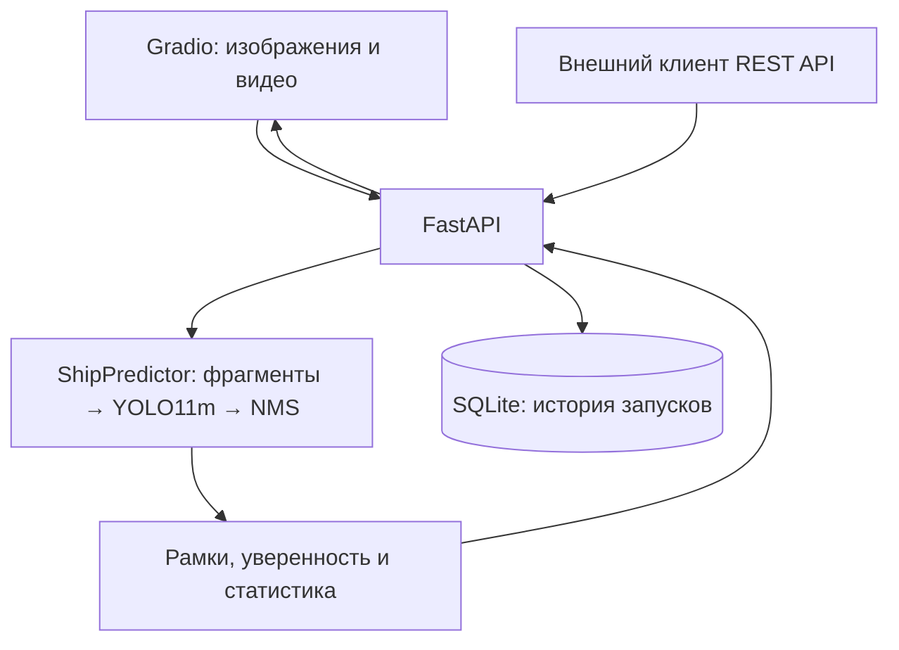

# Ship Detection — детекция кораблей на аэрофотоснимках


Веб-сервис для обнаружения кораблей на аэрофотоснимках с использованием **YOLO11m**. Проект объединяет подготовку данных DOTA v1, эксперименты с пятью архитектурами, обработку больших изображений по фрагментам и приложение с REST API, веб-интерфейсом и историей запусков.

**Ключевой результат:** mAP@0.5 **90,37%** и mAP@0.5:0.95 **66,58%** на подготовленной валидационной выборке DOTA v1 для класса `ship`.

[Демонстрация](#демонстрация) · [Результаты](#результаты-экспериментов) · [Запуск](#быстрый-старт) · [API](#rest-api) · [Обучение](#подготовка-данных-и-обучение)

## Задача проекта

На аэрофотоснимках корабли могут занимать небольшую часть изображения, находиться рядом друг с другом и иметь разный масштаб. Уменьшение большого снимка целиком может приводить к потере деталей небольших объектов.

В проекте реализована детекция по перекрывающимся фрагментам: модель обрабатывает отдельные участки снимка, после чего координаты рамок переносятся на исходное изображение, а дубликаты удаляются с помощью NMS. Результат можно получить через API или посмотреть в браузере.

## Демонстрация


Для изображения интерфейс показывает рамки обнаруженных объектов, их количество, среднюю уверенность модели и время обработки. Для видео выводится сводная статистика по обработанным кадрам. История запросов доступна в отдельной вкладке.

## Возможности

- **Изображения:** координаты рамок, уверенность предсказаний, количество объектов и визуализация результата.
- **Большие снимки:** фрагменты размером 1024 × 1024 пикселя с перекрытием 200 пикселей и объединением предсказаний через NMS.
- **Пакетная обработка:** несколько изображений в одном API-запросе.
- **Видео:** покадровая детекция, количество обработанных кадров, сумма детекций и скорость обработки.
- **История и статистика:** SQLite хранит сведения о запусках, времени обработки, количестве объектов и ошибках; API возвращает последние 20 записей и сводку.
- **Запуск приложения:** локально или через Docker Compose с отдельными сервисами API и UI.
- **Исследовательский пайплайн:** конвертация разметки, подготовка фрагментов, обучение моделей и сбор результатов.

## Результаты экспериментов

В проекте предусмотрены пять экспериментов: YOLOv8n, YOLO11m, RT-DETR-L, Faster R-CNN ResNet50-FPN и RetinaNet ResNet50-FPN. Для сервиса используются веса **YOLO11m**.

Сохранённые результаты моделей Ultralytics на `val`:

| Эксперимент | Модель | mAP@0.5 | mAP@0.5:0.95 | Precision | Recall |
|---|---|---:|---:|---:|---:|
| E1 | YOLOv8n | 0.8835 | 0.5983 | 0.9218 | 0.8392 |
| **E2** | **YOLO11m** | **0.9037** | **0.6658** | **0.9263** | **0.8787** |
| E3 | RT-DETR-L | 0.8139 | 0.5649 | 0.8780 | 0.7851 |

YOLO11m показывает наибольший mAP@0.5 среди этих трёх моделей: преимущество перед базовой YOLOv8n составляет **2,02 процентного пункта**. Размер сохранённых весов YOLO11m — около **39 МБ**.

Источник: [таблица экспериментов](outputs/experiments_table.csv) и [метаданные выбранной модели](models/model_info.yaml). Это результаты сохранённых экспериментов на подготовленных данных проекта, а не оценка на полном официальном тестовом наборе DOTA.

> **Особенность оценки E4 и E5.** Текущий [оценщик torchvision](src/eval/eval_torchvision.py) записывает `Precision × Recall` в поле `mAP50`, а F1 — в `mAP50_95`. Эти величины не являются mAP, поэтому результаты Faster R-CNN и RetinaNet не включены в таблицу прямого сравнения выше. Для сравнения всех пяти архитектур нужен единый расчёт AP.

## Данные и подход

Используется **DOTA v1**, из разметки которого выделяется один класс — `ship`.

1. Отбираются изображения с кораблями; объекты с флагом `difficult=1` пропускаются.
2. Ориентированные четырёхугольники DOTA преобразуются в горизонтальные ограничивающие рамки (**OBB → HBB**) и формат YOLO.
3. Изображения нарезаются на фрагменты **1024 × 1024** с перекрытием **200 пикселей**. Пустые фрагменты по умолчанию не сохраняются.
4. Модели дообучаются с использованием предобученных весов. Общий конфиг задаёт `imgsz=640`, до 50 эпох, `batch=4`, AdamW и начальную скорость обучения `0.001`; фактические настройки зависят от архитектуры и устройства.
5. При обработке большого изображения сервис переносит локальные координаты предсказаний в систему исходного снимка и применяет NMS.

Параметры нарезки описывают размер исходных фрагментов; разрешение входа модели при обучении задаётся отдельно через `imgsz`.

## Архитектура



| Компонент | Технологии |
|---|---|
| Обучение и детекция | Python, PyTorch, Ultralytics, torchvision |
| Обработка изображений и видео | OpenCV, Pillow, NumPy |
| REST API и документация | FastAPI, Uvicorn, OpenAPI |
| Веб-интерфейс | Gradio, HTTPX |
| Хранение истории | SQLite |
| Анализ экспериментов | pandas, Matplotlib, Seaborn |
| Контейнеризация и проверки | Docker Compose, pytest |

## Быстрый старт

### 1. Установка

Требуется **Python 3.10–3.13**. Для первого запуска можно использовать Python 3.11 — эта версия указана и в Dockerfile. Обучающий датасет для запуска сервиса не нужен: веса и пример изображения включены в репозиторий.

```bash
git clone https://github.com/Melnika2003/ship-detection.git
cd ship-detection

python -m venv .venv
```

Активация окружения в Linux / macOS:

```bash
source .venv/bin/activate
```

В Windows PowerShell:

```powershell
.venv\Scripts\Activate.ps1
```

Установка зависимостей:

```bash
python -m pip install -r requirements.txt
```

### 2. Запуск API

Все команды выполняются из корня проекта.

```bash
python -m uvicorn service.api.main:app --host 127.0.0.1 --port 8000
```

- Проверка состояния: [http://127.0.0.1:8000/health](http://127.0.0.1:8000/health).
- Интерактивная документация API: [http://127.0.0.1:8000/docs](http://127.0.0.1:8000/docs).

После загрузки модели `/health` должен возвращать `"model_loaded": true`. Основной путь к весам — `weights/best.pt`; альтернативный — `models/best/weights.pt`.

### 3. Запуск веб-интерфейса

Во втором терминале активируйте то же окружение и выполните:

```bash
python service/ui/app.py
```

Откройте [http://127.0.0.1:7860](http://127.0.0.1:7860) и загрузите [пример изображения](data/samples/sample_ship.jpg) во вкладке «Изображение».

### Docker Compose

Альтернативный способ запуска API и UI одной командой:

```bash
docker compose up --build
```

API будет доступен на порту **8000**, веб-интерфейс — на **7860**. История сохраняется в примонтированной папке `service/db/`, веса подключаются из `weights/` в режиме чтения.

## REST API

| Метод | Маршрут | Назначение |
|---|---|---|
| `GET` | `/health` | Состояние сервиса и загрузки модели |
| `POST` | `/predict` | Детекция на изображении; поле формы `file` |
| `POST` | `/batch_predict` | Обработка нескольких изображений; повторяющееся поле `files` |
| `POST` | `/video_predict` | Покадровая обработка видео; поле формы `file` |
| `GET` | `/stats` | Последние 20 запусков и сводная статистика |

Пример запроса из Linux / macOS; в Windows PowerShell используйте `curl.exe`:

```bash
curl -X POST http://127.0.0.1:8000/predict \
  -F "file=@data/samples/sample_ship.jpg"
```

Ответ `/predict` содержит:

- `detections` — список рамок с координатами `x1`, `y1`, `x2`, `y2` в пикселях исходного изображения, уверенностью `confidence` и классом `class`;
- `num_detections` и `avg_confidence` — количество объектов и среднюю уверенность;
- `latency_ms` и `model_version` — время обработки предиктором и версию модели;
- `visualization_b64` — изображение с рамками, закодированное в Base64.

Полные схемы запросов и ответов доступны в `/docs`.

## Настройка сервиса

| Переменная окружения | По умолчанию | Назначение |
|---|---|---|
| `MODEL_WEIGHTS` | `weights/best.pt`, затем `models/best/weights.pt` | Путь к весам модели |
| `DB_PATH` | `service/db/runs.db` | Файл базы истории |
| `API_URL` | `http://localhost:8000` | Адрес API для Gradio |
| `GRADIO_SERVER_NAME` | `127.0.0.1` | Адрес интерфейса |
| `GRADIO_PORT` | `7860` | Порт интерфейса |
| `VIDEO_MAX_FRAMES` | `0` | Лимит кадров видео; `0` — обработать все |
| `VIDEO_TIMEOUT_SEC` | `1800` | Тайм-аут запроса обработки видео из UI, секунды |

Примеры значений находятся в [.env.example](.env.example). При локальном запуске Python-процессы не загружают этот файл автоматически: переменные нужно задать в окружении перед стартом.

Предиктор по умолчанию использует `conf=0.25`, `iou=0.5`, `patch_size=1024`, `overlap=200` и включённую обработку по фрагментам. При инициализации он читает `config.yaml` **из папки выбранных весов**. Например, при `MODEL_WEIGHTS=models/best/weights.pt` используется [models/best/config.yaml](models/best/config.yaml). Файл [configs/inference.yaml](configs/inference.yaml) текущим API автоматически не применяется.

## Подготовка данных и обучение

Этот раздел нужен для повторения экспериментов. Данные и промежуточные результаты скачиваются и создаются локально; предусмотрите место для архивов, распакованных снимков и нарезанных фрагментов.

```bash
# Скачать DOTA при отсутствии данных, преобразовать разметку и нарезать снимки
python scripts/prepare_all.py

# Запустить серию E1–E5
python scripts/run_all_experiments.py

# Собрать метрики и скопировать веса YOLO11m в папки сервиса
python scripts/collect_results.py

# Построить EDA, сравнение экспериментов и анализ ошибок
python scripts/run_analysis.py
```

Общие гиперпараметры находятся в [configs/train_common.yaml](configs/train_common.yaml), настройки отдельных архитектур — в `configs/exp_e*.yaml`. Перед повторным запуском проверьте устройство и доступную память; для обучения на GPU нужна совместимая установка PyTorch с CUDA.

Отдельный запуск обучения YOLO11m:

```bash
python src/train/train_ultralytics.py --config configs/exp_e2_yolo11m.yaml
```

Скрипты формируют каталог `data/processed/dota_ship_patches/`, результаты экспериментов в `outputs/experiments/` и сводную таблицу `outputs/experiments_table.csv`. Большие данные, промежуточные веса и журналы не входят в состав репозитория.

## Проверки

```bash
# Преобразование разметки и нарезка изображений
python -m pytest tests/test_data_pipeline.py tests/test_split_patches.py -q

# Доступность API и структура сводной статистики
python -m pytest tests/test_smoke.py -q

# Все проверки, включая запрос детекции на реальном примере
python -m pytest tests/ -v
```

Тест реального изображения проверяет успешный ответ и структуру результата; качество детекции оценивается отдельно в экспериментах. При отсутствии изображения или весов этот тест пропускается.

## Структура проекта

| Путь | Содержимое |
|---|---|
| `configs/` | Параметры обучения, конфигурации экспериментов и пример настроек инференса |
| `src/data/` | Конвертация разметки DOTA и нарезка изображений |
| `src/train/` | Обучение моделей Ultralytics и torchvision |
| `src/eval/` | Оценка моделей и скрипты дополнительных экспериментов |
| `src/inference/` | Предиктор, обработка фрагментов, NMS и визуализация |
| `service/api/` | REST API FastAPI |
| `service/ui/` | Веб-интерфейс Gradio |
| `service/db/` | Работа с SQLite и локальная история запусков |
| `scripts/` | Загрузка данных, запуск экспериментов и анализ результатов |
| `weights/best.pt` | Веса YOLO11m для сервиса |
| `models/` | Метаданные и настройки выбранной модели |
| `data/samples/` | Изображение для проверки сервиса |
| `outputs/` | Сводные метрики и опубликованные графики |
| `tests/` | Проверки подготовки данных и API |
| `gif/recording.gif` | Демонстрация приложения |

## Ограничения и дальнейшее развитие

- Модель обучена для одного класса `ship` и возвращает горизонтальные рамки; ориентация кораблей отдельно не оценивается.
- В подготовленной выборке по умолчанию исключаются пустые фрагменты. Перед применением к произвольным снимкам нужна дополнительная оценка на изображениях без кораблей и на данных другого происхождения.
- Метрики в README относятся к сохранённым экспериментам. Время обработки полного снимка зависит от его размера, количества фрагментов и оборудования.

## Что демонстрирует проект

Работу с данными дистанционного зондирования, преобразование разметки, дообучение детекторов, анализ метрик и интеграцию ML-модели в приложение. Отдельное внимание уделено обработке больших изображений, REST API, хранению истории и воспроизводимому запуску через Docker.

Автор: [Melnika2003](https://github.com/Melnika2003).
